# Cloud IAM — Identity & Access Security Lab

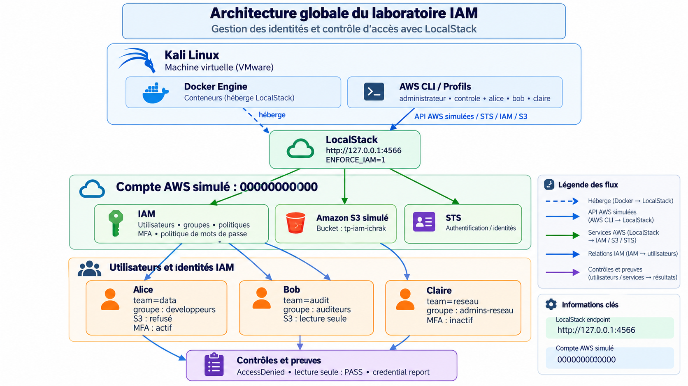

> **Laboratoire reproductible** de sécurisation des identités et contrôle des permissions IAM avec **Kali Linux, Docker, LocalStack et AWS CLI**. Les captures démontrent les opérations effectivement observées dans un environnement Cloud simulé.

## Objectifs

Créer des identités, associer des groupes et permissions, observer l’authentification indépendamment de l’autorisation, appliquer une politique de mot de passe, activer un MFA virtuel et vérifier les identités via un rapport des credentials.

## Périmètre et limites

- **Environnement :** VMware / Kali Linux, Docker, LocalStack avec `ENFORCE_IAM=1`, AWS CLI en `eu-west-3`.
- **Compte :** `000000000000` (identifiant local fictif).
- **Endpoint :** `http://127.0.0.1:4566` ; aucune action sur un compte AWS de production.
- **Limites :** le comportement LocalStack est simulé, le refus `AccessDenied` a cependant été réellement observé. Le test ne constitue pas un audit AWS réel.
- **Sécurité des preuves :** codes TOTP masqués. Aucun secret MFA ni clé privée dans le dépôt.

## Architecture

L’instance Kali exécute AWS CLI contre l’API LocalStack exposée en boucle locale. LocalStack simule STS, IAM et S3. La politique attachée au groupe **auditeurs** autorise les lectures S3 de Bob ; Alice n’hérite d’aucune autorisation S3. L’appareil MFA virtuel est associé à Alice.

Schéma global sur fond blanc, adapté aux différentes étapes du laboratoire.

## Résultats clés

| Test | Observation réelle | Portée |
|---|---|---|
| STS `controle` | Authentification confirmée par `user/controle` | Identité reconnue |
| S3 `controle` | `AccessDenied` pour `s3:ListAllMyBuckets` | Refus par défaut appliqué |
| S3 `alice` | `AccessDenied` | Identité sans permission |
| S3 `bob` : liste | Bucket `tp-iam-ichrak` visible | Lecture héritée du groupe `auditeurs` |
| S3 `bob` : création | `AccessDenied` pour `s3:CreateBucket` | Lecture seule respectée |
| Politique mots de passe | Minimum 14 ; historique 5 ; pas d’expiration forcée | Paramètres confirmés |
| MFA Alice | Appareil `alice-mfa` présent | Enrôlement confirmé |
| Credential report | Alice MFA=true ; Bob/Claire MFA=false | État des identités documenté |

## Utilisateurs et groupes

| Utilisateur | Étiquette | Groupe | Autorisation S3 documentée | MFA |
|---|---|---|---|---|
| alice | `team=data` | `developpeurs` | Liste refusée | Actif |
| bob | `team=audit` | `auditeurs` | Liste permise ; création refusée | Inactif |
| claire | `team=reseau` | `admins-reseau` | Non testée dans les preuves | Inactif |

## Analyse chronologique des preuves

### 1. Préparation de l’environnement

**01 — Démarrage de LocalStack avec ENFORCE_IAM=1.** Le conteneur est lancé avec l’application des permissions IAM demandée par le laboratoire. L’option doit être vérifiée par un test de refus réel.

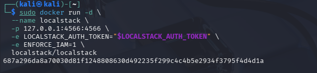

**02 — État du conteneur Docker.** Le conteneur LocalStack apparaît actif et expose le port 4566 sur l’interface locale.

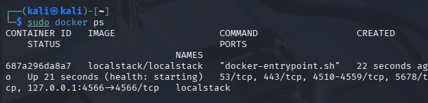

**03 — État de santé des services.** L’API /_localstack/health répond ; la disponibilité des services ne démontre pas à elle seule l’application des politiques IAM.

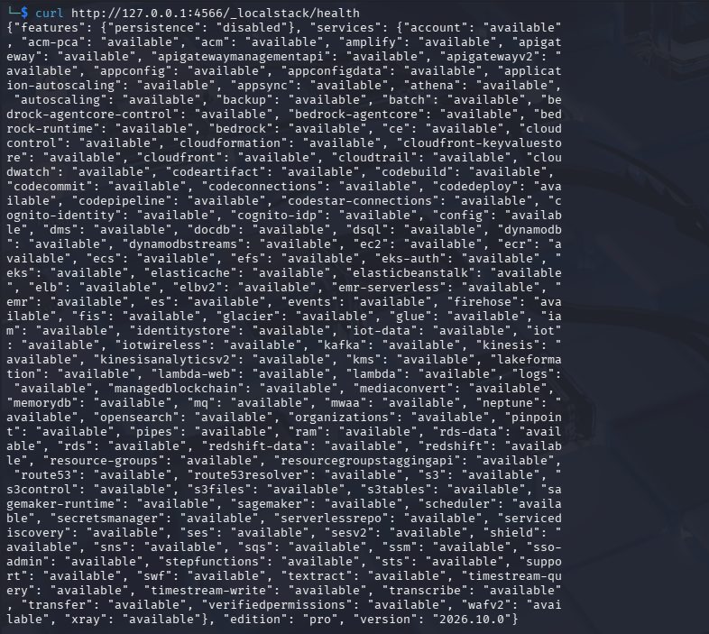

**04 — Configuration AWS CLI.** Identifiants de test et endpoint local 127.0.0.1:4566 : les opérations ciblent l’émulateur, pas AWS en production.

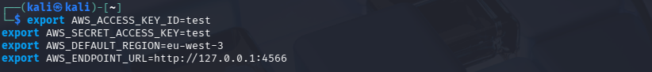

**05 — Identité STS de l’administrateur.** STS renvoie l’ARN root du compte simulé 000000000000.

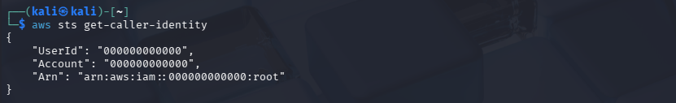

**06 — Identifiant du compte.** Le numéro de compte local 000000000000 est stocké dans ACC pour construire les ARN IAM.

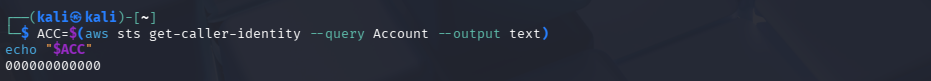

### 2. Création des identités et profils

**07 — Création de controle.** Un utilisateur sans politique IAM est créé pour tester le refus par défaut.

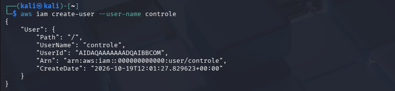

**08 — Clé d’accès de controle.** Une clé d’accès est créée ; les valeurs sont capturées dans des variables sans afficher la clé secrète.

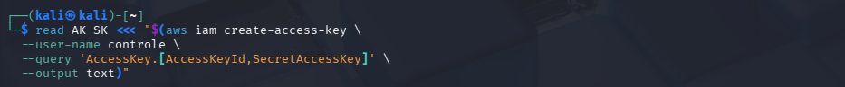

**09 — Profil CLI de controle.** Le profil AWS CLI utilise les identifiants propres à controle pour séparer l’authentification administrateur et utilisateur.

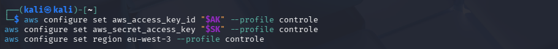

**11 — STS de controle.** STS confirme l’ARN user/controle : authentification réussie, sans autorisation S3.

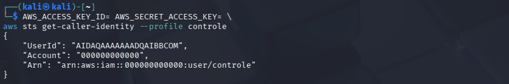

**12 — Suppression du compte de contrôle.** La clé d’accès de controle et l’utilisateur de test sont supprimés.

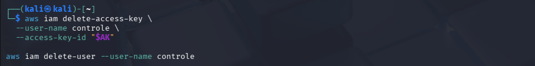

**13 — Création des utilisateurs IAM.** Alice (data), Bob (audit) et Claire (reseau) sont créés avec leurs tags team.

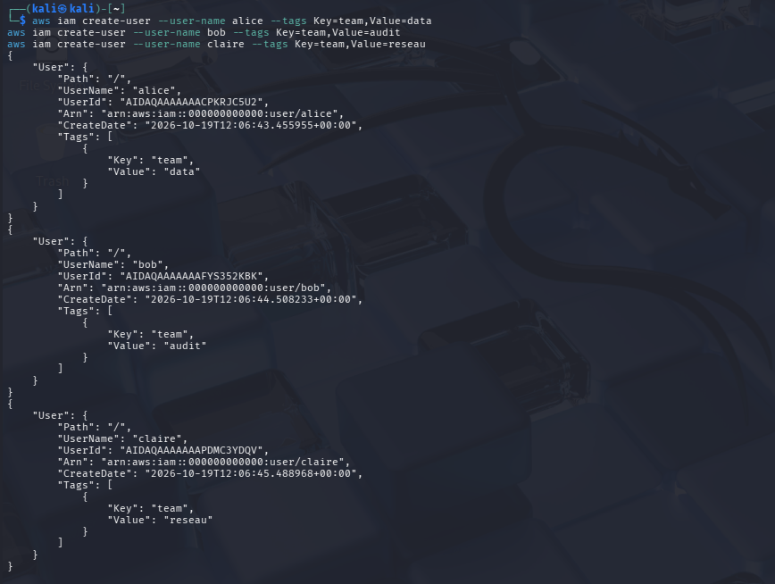

**14 — Liste des utilisateurs.** La commande list-users confirme l’existence des trois identités IAM.

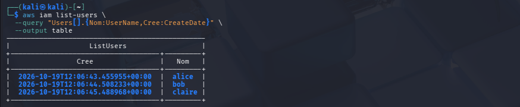

**15 — Authentification d’Alice.** Le profil Alice est reconnu par STS ; cette identité n’a pas encore de droit S3.

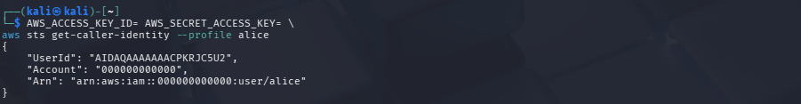

### 3. Autorisations et refus par défaut

**10 — Refus S3 pour controle.** La requête s3:ListAllMyBuckets échoue avec AccessDenied : preuve de l’implicit deny.

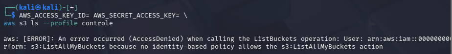

**16 — Création des groupes.** Les groupes developpeurs, auditeurs et admins-reseau sont créés.

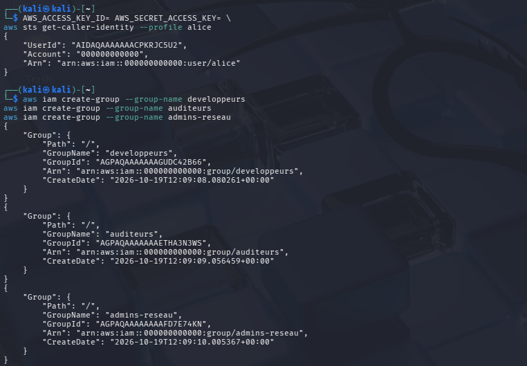

**17 — Affectation des utilisateurs.** Alice appartient à developpeurs, Bob à auditeurs et Claire à admins-reseau.

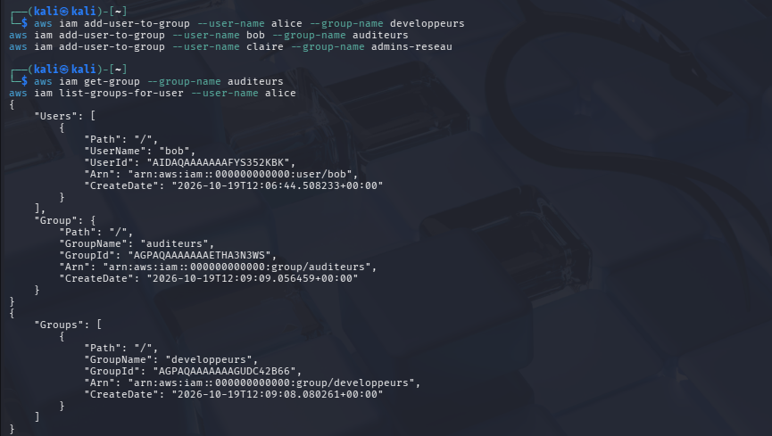

**18 — Bucket et refus d’Alice.** Le bucket tp-iam-ichrak est créé par l’administrateur ; Alice obtient AccessDenied sur le listing.

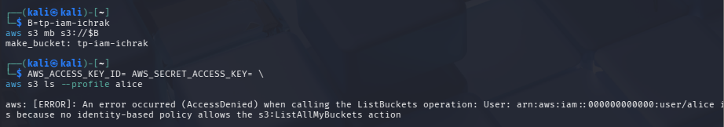

**19 — Politique de lecture seule.** AmazonS3ReadOnlyAccess est attachée au groupe auditeurs, dont Bob est membre.

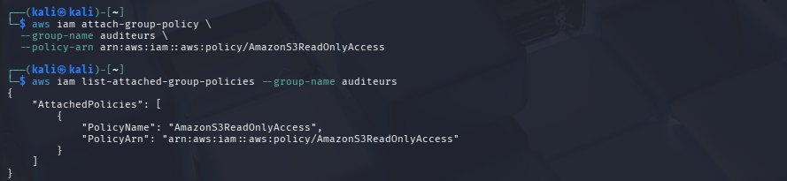

**20 — Comparaison des droits.** Bob peut lister les buckets mais sa tentative de création échoue ; Alice reste refusée.

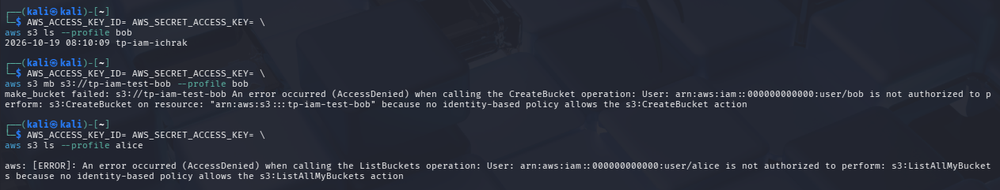

### 4. Politique de mot de passe

**21 — Définition de la politique.** Configuration demandant au moins 14 caractères, un historique de 5 mots de passe et aucune expiration forcée.

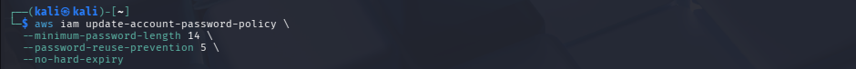

**22 — Vérification de la politique.** La réponse IAM confirme MinimumPasswordLength=14, PasswordReusePrevention=5 et ExpirePasswords=false.

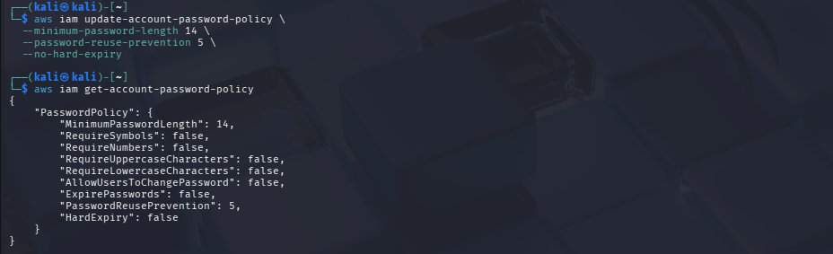

### 5. Authentification MFA

**23 — Installation oathtool.** Installation de l’outil permettant de calculer des codes TOTP dans le laboratoire.

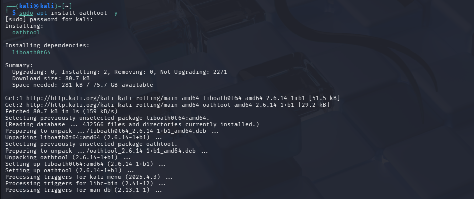

**24 — Création du MFA virtuel.** L’appareil alice-mfa est créé et son ARN apparaît ; le secret Base32 reste privé.

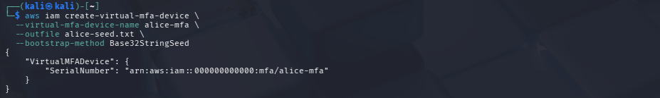

**25 — Activation MFA (codes masqués).** Commande d’activation du MFA pour Alice. Les deux codes TOTP présents dans l’original ont été intégralement masqués.

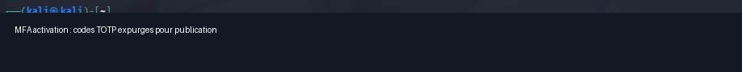

**26 — Vérification du MFA.** list-mfa-devices atteste l’enrôlement du dispositif alice-mfa pour Alice.

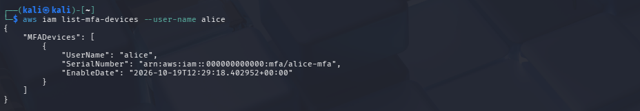

### 6. Inventaire des identités

**27 — Rapport des identifiants.** Le credential report liste les champs user, mfa_active et access_key_1_active.

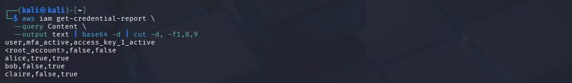

**28 — Confirmation de l’inventaire.** L’inventaire confirme Alice MFA=true, Bob/Claire MFA=false, et des clés d’accès actives pour les trois comptes.

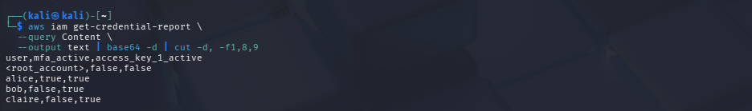

## Analyse sécurité

**Authentification ≠ autorisation.** Le STS de `controle` et d’Alice valide leur identité ; une demande S3 peut néanmoins être refusée si aucune politique ne l’autorise.

**Permissions héritées d’un groupe.** La politique AWS gérée `AmazonS3ReadOnlyAccess`, attachée à `auditeurs`, permet à Bob de lister les buckets mais pas d’en créer.

**Authentification renforcée.** L’enrôlement MFA d’Alice est attesté par `list-mfa-devices`, puis le rapport des identifiants. Une clé d’accès IAM active n’est pas automatiquement soumise à MFA pour chaque appel signé.

**Politique de mots de passe.** La longueur minimale et la prévention de réutilisation s’appliquent aux mots de passe de console IAM ; les clés d’accès AWS CLI relèvent d’un mécanisme différent.

**Recommandations.** Préférer les rôles et identifiants temporaires aux clés durables ; appliquer le moindre privilège ; surveiller les clés non utilisées ; privilégier MFA résistant au phishing lorsque disponible ; renouveler les secrets de laboratoire compromis.

## Inventaire observé

| Identité | `mfa_active` | `access_key_1_active` |
|---|---|---|
| `<root_account>` | false | false |
| alice | true | true |
| bob | false | true |
| claire | false | true |

## Reproduire le laboratoire

```bash
sudo docker run -d --name localstack -p 127.0.0.1:4566:4566 \
  -e LOCALSTACK_AUTH_TOKEN="$LOCALSTACK_AUTH_TOKEN" \
  -e ENFORCE_IAM=1 localstack/localstack

export AWS_ACCESS_KEY_ID=test
export AWS_SECRET_ACCESS_KEY=test
export AWS_DEFAULT_REGION=eu-west-3
export AWS_ENDPOINT_URL=http://127.0.0.1:4566
aws sts get-caller-identity
```

Le `LOCALSTACK_AUTH_TOKEN` doit provenir de votre compte de test ; ne pas le committer. L’enforcement IAM peut dépendre du plan LocalStack. **Vérifier d’abord** qu’un utilisateur sans politique reçoit `AccessDenied` : sinon, les tests d’autorisation ne sont pas concluants.

## Organisation du dépôt

```text
assets/              Schéma d’architecture (PNG)
evidence/            28 preuves renommées et classées par étape
docs/CAPTURES.md     Explications détaillées et visuels de chaque capture
docs/CORRESPONDANCE_IMAGES.csv  Anciens et nouveaux noms
README.md            Analyse principale
```

## Règles de confidentialité

Ne publiez jamais `~/.aws/credentials`, un `LOCALSTACK_AUTH_TOKEN`, `alice-seed.txt`, une clé d’accès secrète, un code TOTP ou un QR code MFA. La capture de l’activation MFA a été **expurgée**.

## Conclusion

Le laboratoire démontre concrètement la séparation **authentification / autorisation**, le **refus implicite**, l’**héritage des permissions IAM par les groupes**, la **politique de mots de passe** et l’**activation MFA**. Les résultats sont obtenus avec une simulation locale et ne préjugent pas de la posture d’un compte AWS réel.
